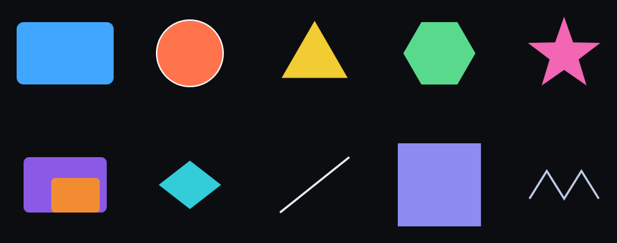

# RigWorks

[](https://github.com/rigkid/RigWorks/stargazers)
[](docs/history.md)
[](LICENSE)



**A no-code application framework.**  
*Because no code is the best code.*  
**Rig** - Readable Independent Grammar.

[RigWorks](https://rig.works) - **Rig** for short, and Rig in all running text - is a shared data vocabulary for applications. It is future-proof, host-independent, and human-readable: open the JSON, change a field, load it in another app. It is a framework you never install - no library to link, no runtime to embed, no API to version. It ships as agreement: a grammar of schema ids and entity/component POD documents. Apps that speak the same schema ids share fields and units, so their content interoperates without either app knowing the other exists.

## It runs

A Rig document is not a diagram of a format. The same JSON presents in more than one fulfillment without either knowing the other:

- **SVG** - [`examples/minimal-scene.json`](examples/minimal-scene.json) drawn by [`tools/render-svg.mjs`](tools/render-svg.mjs) (the picture at the top of this page)
- **[RigViewer](https://github.com/rigkid/RigViewer)** - *presents*: the still document, drawn. [Open it](https://rigkid.github.io/RigViewer/) - drop a `.json` and look
- **[RigPlayer](https://github.com/rigkid/RigPlayer)** - *plays*: the document over time (transport, animation, sound). [Play one now](https://player.rig.works/) - drop a `.rig`, press play, share the link
- **[RigKit](https://github.com/rigkid/RigKit)** - *builds hosts*: desktop / Pi reference host (GLFW, packs)

Any app that already has Setup / Update / Draw / Exit can honor the same schemas. Host-only fields stay in `x.<vendor>.*` extensions so they do not pollute the portable ones. Emitted documents pass `rig-validate --strict`.

**Concept is more important than execution.** What a transform *is* outlives every renderer that ever drew one. Rig keeps the concept and leaves the execution to you - [design philosophy](docs/design-philosophy.md), [why no code](docs/why-no-code.md).

**AI co-coding is here to stay.** When execution gets cheap, the shared concept becomes the scarce asset. The cheapest token is the one the model never generates: it writes the document and leaves the system unwritten, and the next agent already accepts that document. Rig publishes the concept in a form people and models read the same way - [AI collaboration](docs/ai-collaboration.md#the-cheapest-token).

**What it costs.** A data framework moves work rather than deleting it. Live hosts write the loop; nothing fails to build when you drift; a schema only pays off once a second host speaks it - [the honest price](docs/why-no-code.md#the-honest-price).

**For agents and editors.** [`tools/rig-mcp`](tools/rig-mcp/) serves the Contract over MCP (`list_schemas`, `get_schema`, `find_examples`, `validate_document`, `get_skill`) so Claude, Cursor, and peers call Rig directly. Editors get autocomplete and inline validation for `.rig` files from the published schema catalog - point `json.schemas` at `https://rig.works/schemas/catalog.json` ([`schemas/catalog.json`](schemas/catalog.json)); this repo's [`.vscode/settings.json`](.vscode/settings.json) shows the local form.

## The framework

1. **Grammar** - schema ids, field names, units, and entity/component [POD composition](docs/ecs.md). Enough to **be Rig** ([honors](docs/honors.md)).
2. **Schemas** - agreed POD field layouts ([prose](schemas/) + [JSON Schema](schemas/json/)). Ship what you support.
3. **Properties** - portable [datatype](docs/properties.md) rows.
4. **Live hosts** - [SUDE](docs/sude.md) (Setup / Update / Draw / Exit) plus runtime ECS systems.
5. **Optional UI** - [Rig + UI](docs/ui.md) editing the same data.

Words used precisely - Contract, fulfillment, host, pack: [docs/terms.md](docs/terms.md).

Wire format is **JSON** ([`rig.document`](schemas/document.md)). Validate generated output:

```bash
npm run setup                                          # once - installs the validator
node tools/rig-validate/cli.js examples/minimal-scene.json
npm run check                                          # schemas, parity, links, reference documents
```

## Worked example

Live hosts run a SUDE loop; portable content is ECS components on entities:

```text
Setup: spawn / load entities
Update: simulate (modulators, transport, ...)
Draw: present
Exit: tear down
```

One entity in Contract JSON ([`examples/minimal-scene.json`](examples/minimal-scene.json)):

<!-- rig:begin entity=demo-rect from=examples/minimal-scene.json -->
```json
{
  "id": "demo-rect",
  "components": {
    "rig.meta.named": {
      "name": "demo-rect",
      "stableId": "demo-rect"
    },
    "rig.spatial.transform": {
      "position": [
        20,
        65,
        0
      ],
      "rotation": [
        0,
        0,
        0,
        1
      ],
      "scale": [
        1,
        1,
        1
      ]
    },
    "rig.spatial.relationship": {
      "parent": "world"
    },
    "rig.geometry.rectangle": {
      "x": 0,
      "y": 0,
      "width": 140,
      "height": 90,
      "cornerRadius": 10
    },
    "rig.paint.fill_stroke": {
      "fillRgba": [
        0.25,
        0.65,
        1,
        1
      ]
    },
    "rig.interact.selectable": {
      "enabled": true
    }
  }
}
```
<!-- rig:end -->

More patterns: [`examples/`](examples/). Interchange notes (`.rig` / `.rigz`): [`docs/interchange.md`](docs/interchange.md).

## For AI agents

The cheapest token is the one the model never generates. Load the skill, copy one example, emit the document, and validate. Leave the catalog unloaded. A document one agent emits is data the next agent already accepts, so the handoff spends nothing on a private format. The reason: [`docs/ai-collaboration.md`](docs/ai-collaboration.md#the-cheapest-token).

Load the condensed skill before generating Rig data: [`skills/generating-rig-documents/SKILL.md`](skills/generating-rig-documents/SKILL.md). Cross-agent onboarding: [`AGENTS.md`](AGENTS.md). Discovery index: [`llms.txt`](llms.txt).

Always validate emission:

```bash
node tools/rig-validate/cli.js path/to/doc.json
```

## Reference host

[RigKit](https://github.com/rigkid/RigKit) fulfills Rig on desktop (GLFW / OpenGL / packs). The family lives under the [rigkid](https://github.com/rigkid) org: **RigWorks** is the spec, **RigKit** is the reference host. RigKit's `minimal` demo presents the same scene shape family as `examples/minimal-scene.json` - the picture at the top of this page is that document drawn by the in-repo SVG fulfillment, [`tools/render-svg.mjs`](tools/render-svg.mjs).

## Version

See [`VERSION`](VERSION) (SemVer) and [docs/versioning.md](docs/versioning.md).

## More reading

| Why Rig | |
|---------|--|
| [docs/design-philosophy.md](docs/design-philosophy.md) | Future-proof, host-independent, human-readable - the tablet |
| [docs/why-no-code.md](docs/why-no-code.md) | Why a framework with no code, and what it costs |
| [docs/ai-collaboration.md](docs/ai-collaboration.md) | Why shared concepts beat private prompts when models author work |

| Contract | |
|----------|--|
| [docs/terms.md](docs/terms.md) | Contract, fulfillment, host, pack, POD |
| [docs/honors.md](docs/honors.md) | The minimum bar - is it Rig? |
| [docs/ecs.md](docs/ecs.md) | Entity-component conventions |
| [docs/sude.md](docs/sude.md) | Setup / Update / Draw / Exit |
| [docs/ui.md](docs/ui.md) | Optional UI layer over the same data |
| [docs/versioning.md](docs/versioning.md) | SemVer, maturity tiers, and the 1.0 freeze |
| [docs/history.md](docs/history.md) | Release notes, one row per version |
| [docs/gaps.md](docs/gaps.md) | Where the Contract is silent, ambiguous, or wrong |

| Data and exchange | |
|-------------------|--|
| [schemas/README.md](schemas/README.md) | Catalog of schema ids |
| [schemas/json/](schemas/json/) | Machine grammar |
| [schemas/document.md](schemas/document.md) | Document envelope |
| [docs/interchange.md](docs/interchange.md) | Wire format and `.rig` / `.rigz` package |
| [docs/properties.md](docs/properties.md) | Portable datatypes |
| [examples/](examples/) | Reference documents |

| Format mappings | |
|-----------------|--|
| [docs/idml.md](docs/idml.md) | IDML to `rig.layout.frame` + layout / story; encodings are fulfillment |
| [docs/kicad.md](docs/kicad.md) | KiCad board to `rig.circuit.*` / `rig.pcb.*`; round trip merges onto the source file |
| [docs/openbim.md](docs/openbim.md) | OpenBIM (IFC / BCF / IDS) to `rig.bim.*` |
| [docs/print.md](docs/print.md) | FGF / pellet to `rig.print.*`; not envelope `pdfX`, not a layout page |
| [docs/ufo.md](docs/ufo.md) | UFO / GLIF to `rig.font.*`; encodings are fulfillment |

| Domain mappings | |
|-----------------|--|
| [docs/dev.md](docs/dev.md) | Dev machines to `rig.dev.machine` / `rig.dev.op`; fulfillments e.g. RigDev |
| [docs/records.md](docs/records.md) | Payments, encounters, catalog rows, and case files; encodings are fulfillment |
| [docs/robot.md](docs/robot.md) | Design, simulate, test, and train robots; solvers and trainers are fulfillment |
| [docs/ros.md](docs/ros.md) | ROS 2 to existing schemas; no `rig.ros2.*` |
| [docs/vr.md](docs/vr.md) | VR to `rig.vr.*` plus camera, transform, and input; runtimes are fulfillment |

| Working with models | |
|---------------------|--|
| [skills/generating-rig-documents/SKILL.md](skills/generating-rig-documents/SKILL.md) | The skill to load before generating |
| [tools/](tools/) | Validator, parity, and link checks |

## License

MIT - [LICENSE](LICENSE).
